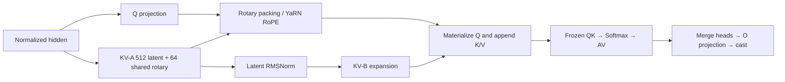

# Native attention, MLA and RoPE

- [DeepSeek-V2-Lite MLA execution design and hardware checks](#mlu-attention-mla-design)
- [Checkpoint-backed Q and KV projection acceptance](#mlu-qkv-projection-acceptance)
- [DeepSeek-V2-Lite YaRN RoPE acceptance](#mlu-rope-acceptance)
- [Phase 10 design and repository audit](#phase10-design-and-audit)
- [Phase 10 native MLA acceptance](#phase10-mla-acceptance)

## DeepSeek-V2-Lite MLA execution design and hardware checks

### Eager checkpoint contract

The contiguous Q projection `[B,S,16,192]` has strides `[S*3072,3072,192,1]`. The head-first view `[B,16,S,192]` has strides `[S*3072,192,3072,1]` until materialization. Q splits into 128 nonrotary and 64 rotary values. KV-A yields one normalized latent of width 512 and one shared 64-wide rotary key per token. KV-B yields a head-first view of `[B,16,S,256]` with strides `[S*4096,256,4096,1]` before splitting. The reference assembles K with nonrotary keys and the broadcast rotary key. It caches expanded K `[B,16,L,192]` and V `[B,16,L,128]` through the configured cache object. A contiguous implementation may allocate row-major versioned tensors, while the incoming V split has the parent KV-B stride. Cache layout must be explicit at the adapter boundary.

QK scores are scaled by `192^(-1/2) * yarn_get_mscale(40,0.707)^2`. Eager attention accepts additive mask `[B,1,S,L]`, uses FP32 softmax then casts probabilities to activation dtype, and multiplies by V. Padding and causal offset must agree with the reference, especially for unequal query/cache lengths. Attention dropout is zero at inference. Reference RoPE is applied to Q and the shared K rotary component before cache update.

### Compressed alternative

A development cache can keep normalized latents `[B,L,512]` and rotated shared keys `[B,L,64]`, each contiguous in the last dim. With per-head KV-B matrices `Wk,Wv[128,512]`, absorb the key projection into Q as `(Q_nope·Wk)·latent^T` plus the rotary dot. Apply the same scale and mask. Mix latents with attention probabilities, then apply `Wv^T`. This is an FP32 algebraic identity. Low-precision intermediate rounding differs and must be evaluated under the matched semantic contract before replacing eager/cache behavior.

### Standalone hardware test

On MLU 5 (`0000:b3:00.0`), the fixture used real layer-zero KV-B weights, deterministic normalized-latent and rotated Q/K inputs, all 16 heads, and query/cache lengths 7/7, 1/65 and 3/65. Torch MLU operations exercised causal prefill and offset cache read shapes. It did not allocate or append a serving cache or run a custom fused MLA kernel. The FP32 materialized and absorbed formulations passed all 12 cases at the fixed `1e-5 + 1e-5*abs(ref)` gate. The largest FP32 difference was 5.96046448e-8.

**Low-precision model-order parity is not accepted.** Five of six cases passed. One FP16 7/7 prefill output differed by 1.52587890625e-5, beyond the same threshold. The tolerance was preserved, and the harness exited 1. Stage diagnostics found the first differences after KV-B rounding (30 values, max 0.0001220703125). Rounded probabilities agreed. The FP32 AV step differed by up to 7.7560544e-6 before final FP16 rounding. These observations identify a boundary for debugging. They do not establish a hardware defect or justify loosening the tolerance.

[MLA accuracy CSV](../artifacts/logs/phase5_mla_accuracy.csv) · [Stage diagnostics and exit log](../artifacts/logs/phase5_mla_run.log)

## Checkpoint-backed Q and KV projection acceptance

**Hardware PASS on host MLU 2 (`0000:6f:00.0`).** The fixture exporter reads full BF16 layer-zero Q, KV-A, KV-B and latent gamma tensors directly from safetensors. Activations are deterministic synthetic values. FP16 cases convert the source BF16 weights explicitly. One packed device weight per dtype and projection is reused across M=1, 2, 4, 8, 32, 64 and 128. CNNL uses the same logical inputs and resident unpacked weights. Outputs are compared to independent increasing-K FP32 accumulation with the existing `1e-5 + 1e-5*abs(ref)` threshold.

All 84 comparison rows passed with no nonfinite output. Maximum absolute error across all runs was 1.78813934e-7. Each timing uses five warmups and 30 samples. Kernel timings use queue notifiers. Transfer-inclusive timing adds A H2D, synchronization and FP32 C D2H, with both RHS representations resident. Weight H2D and pack-ready wall time are reported separately in the command log. That wall interval includes packing allocation and synchronization. The first BF16 Q preparation includes a cold path. It is a single observation, with no warmup redistribution.

| BF16 projection | M=1 BANG / CNNL median kernel µs | M=128 BANG / CNNL median kernel µs |
| --- | ---: | ---: |
| Q | 26.90 / 8.74 | 184.78 / 13.94 |
| KV-A | 17.62 / 7.40 | 42.18 / 8.44 |
| KV-B | 6.32 / 5.58 | 45.56 / 12.48 |

The connected KV path uses real KV-A, norm gamma and KV-B weights. Native preparation uses host packing once. The device casts and compacts 512 latent columns from a 576-stride FP32 intermediate, applies the accepted native RMSNorm, and submits KV-B on the same queue. Both dtypes passed M=1 and M=32 with zero mismatches. Worst absolute error was 7.72625208e-6 in FP16 M=32. This is one connected projection subgraph without attention.

[Projection accuracy/performance CSV](../artifacts/logs/phase5_projection_accuracy_performance.csv) · [Preparation and commands](../artifacts/logs/phase5_projection_run.log) · [Connected KV accuracy](../artifacts/logs/phase5_kv_chain_accuracy.csv) · [Connected KV build and run](../artifacts/logs/phase5_kv_chain_run.log)

## DeepSeek-V2-Lite YaRN RoPE acceptance

**Hardware PASS on host MLU 4 (`0000:af:00.0`).** The test extracts the checkpoint's original PyTorch YaRN helper and rotation functions. The configuration uses factor 40, theta 10000, original context 4096, beta_fast 32, beta_slow 1 and both mscale parameters 0.707. It generates a compact coefficient table for the tested position IDs. The native BANG kernel looks up explicit indices into that table. A serving implementation must provide the matching position-to-table mapping.

Inputs pack 16 Q heads and one shared K head as contiguous `[17,S,64]` with element strides `[S*64,64,1]`. The original interleaved even/odd pairs are reordered to halves, then rotated. The two products round separately to the input dtype before addition and final rounding, matching the checkpoint expression. Coefficients are stored in the input dtype.

FP16 and BF16 sequence lengths 1, 7 and 65 passed. The cases include position 0, the original 4096 boundary, repeated positions, reverse order and positions up to 163839. Across **158,848** outputs, the native kernel matched all expected bits with zero signed-zero differences and zero absolute error. PyTorch generated the coefficient tables on CPU. No native coefficient generation or RoPE performance measurement was performed.

[Accuracy CSV](../artifacts/logs/phase5_rope_accuracy.csv) · [Fixture and compiler log](../artifacts/logs/phase5_rope_run.log)

## Phase 10 design and repository audit

The original eager DeepSeek-V2-Lite MLA keeps a 512-wide latent and a shared 64-wide rotary key during projection. KV-B expands the normalized latent to 16 nonrotary K/V heads. The eager cache stores expanded K and V after RoPE. The absorbed formulation changes low-precision rounding and has a recorded FP16 tolerance failure, so this implementation follows the materialized checkpoint path.

The legacy R6 fixture contains device projection, a float device cache copy, host-side reformatting, and CPU reference MLA. It has no reusable request cache API. The Phase 9.4 checkpoint harness starts at already materialized Q/K/V and exercises all three native attention operators. The shared dispatch still has a QK placeholder, and its RoPE entry point reads positions to host before launch. Phase 10 directly reuses the accepted queue launchers and produces bounded positions on the device. The integration uses the prior Phase 8 candidate GEMM and Phase 8.2 device-only exact-rsqrt latent norm. Those components were validated in the projection fixture. The Phase 10 path uses no CPU reference arithmetic.

### Tensor and lifecycle contract

| Tensor | Layout |
| --- | --- |
| Input | `[S,2048]` low precision, after input RMSNorm |
| Q and KV-A GEMM staging | `[S,3072]`, `[S,576]` FP32, converted at the same boundaries as the checkpoint |
| KV-A compact and normalized latent | `[S,512]` low precision |
| KV-B | `[S,4096]` FP32 staging, split as 16 groups of 128 K and 128 V channels |
| RoPE input/output | `[17,S,64]` low precision, absolute positions `[S]` |
| Materialized Q | `[16,S,192]` low precision |
| Persistent K, V | `[16,capacity,192]`, `[16,capacity,128]` low precision |
| Attention | `[16,S,L]` scores and probabilities, AV `[16,S,128]` |
| Output | `[S,2048]` low precision |

One request owns its cache and scratch buffers for its lifetime. The cache stride is physical capacity, and the valid length is committed only after the owning queue completes. An append only writes past the previous length. Reset clears the logical length and decode restarts at position zero. Out-of-order appends, writes past capacity and mutation while pending are rejected on the host. Requests on either one queue or separate queues use disjoint allocations. Logical batching is a group of independent requests. The original checkpoint has exactly 16 heads, so other head configurations are outside this model interface.

K+V use 10,240 bytes per cached token per request. The three FP32 score/probability buffers and two 16-bit score/probability buffers use 16 bytes per score for up to `16 × max_chunk × capacity` scores. Projection and layout staging scales with the maximum chunk. RoPE tables and four packed projection weights can be shared across requests. Stage traces and canary checks are harness-only device downloads after queue completion.

### Execution plan and acceptance gates

1. Capture the original checkpoint MLA boundary from normalized Layer 0 input, including real projection weights, RoPE tables, materialized Q/K/V, probabilities, and final output for each dtype.
2. Add device layout/cast and cache append kernels and a request-owned runtime entry point around the existing projection, norm, RoPE and attention launchers. Test cache roundtrip and actual attention reads using the same queue.
3. Compare native intermediate and final stages at `1e-5 + 1e-5 * abs(reference)`. Exercise lengths 1, 7, 32 and 128, repeated decode, capacity rejection and reset. Run one request, multiple requests sharing one queue, and multiple requests on two queues. Verify actual cache contents, guard regions and allocation reclamation.
4. Run Phase 9.4 regressions and verify frozen sources. Record the legacy R6 baseline separately. Benchmark only after the numerical and lifecycle gates pass.

## Phase 10 native MLA acceptance

**PASS for the materialized DeepSeek-V2-Lite Layer 0 attention interface.** The input is the checkpoint's normalized hidden state `[S,2048]`. All model computation from that boundary through low-precision O projection output executes on MLU590-M9 card 0. The original checkpoint uses 16 heads. The reusable `MlaRequest` API groups independent requests on one or two queues. No host computation is used between stages.

The new `layout.mlu` kernels form the rotary input and absolute positions, cast and arrange Q, append expanded K/V, merge the AV heads, and cast the O projection. `mla.cpp` submits the accepted Phase 8 projection and latent RMSNorm arithmetic, YaRN RoPE, and the frozen Phase 9.4 QK, Softmax and AV launchers. The absorbed MLA formulation and fused batched GEMM are outside this interface.

| Boundary | Shape | Values checked per dtype | Bit differences |
| --- | --- | ---: | ---: |
| Q projection, after checkpoint cast | `[S,3072]` | 7,041,024 | 0 |
| KV-A projection, after checkpoint cast | `[S,576]` | 1,320,192 | 0 |
| Normalized latent | `[S,512]` | 1,173,504 | 0 |
| KV-B projection, after checkpoint cast | `[S,4096]` | 9,388,032 | 0 |
| Materialized Q, including rotated channels | `[16,S,192]` | 7,041,024 | 0 |
| Masked QK and Softmax probabilities | `[16,S,L]`, each | 3,900,576 | 0 |
| Merged AV and final O projection | `[S,2048]`, each | 4,694,016 | 0 |
| Decode O projection versus full-sequence PyTorch | `[1,2048]` | 147,456 | 0 |

Per-case maximum absolute, mean absolute, maximum relative and RMS errors were zero at the checkpoint boundaries above, with ULP histograms entirely at zero. The CSV distinguishes the checkpoint cast of FP32 GEMM staging from outputs physically stored in BF16 or FP16. The expected negative infinities from causal masks matched exactly. No unexpected NaN or Inf occurred.

The reference executes the original eager attention source with real Layer 0 weights and independent BF16 and FP16 captures. The test compares Q and expanded K after RoPE, including all rotated and nonrotary channels, and checks the generated positions explicitly. Input normalization preceding the attention interface was computed for fixture generation and is outside this acceptance.

[Per-case MLA accuracy](../artifacts/logs/phase10_mla_accuracy.csv) · [Design and layouts](#phase10-design-and-audit)
