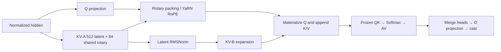

# Phase 10 design and repository audit

The original eager DeepSeek-V2-Lite MLA keeps a 512-wide latent and a shared 64-wide rotary key during projection. KV-B expands the normalized latent to 16 nonrotary K/V heads. The eager cache stores expanded K and V after RoPE. The absorbed formulation changes low-precision rounding and has a recorded FP16 tolerance failure, so this implementation follows the materialized checkpoint path.

The legacy R6 fixture contains device projection, a float device cache copy, host-side reformatting, and CPU reference MLA. It has no reusable request cache API. The Phase 9.4 checkpoint harness starts at already materialized Q/K/V and exercises all three native attention operators. The shared dispatch still has a QK placeholder, and its RoPE entry point reads positions to host before launch. Phase 10 directly reuses the accepted queue launchers and produces bounded positions on the device. The integration uses the prior Phase 8 candidate GEMM and Phase 8.2 device-only exact-rsqrt latent norm. Those components were validated in the projection fixture. The Phase 10 path uses no CPU reference arithmetic.

## Tensor and lifecycle contract

| Tensor | Layout |
| --- | --- |
| Input | `[S,2048]` low precision, after input RMSNorm |
| Q and KV-A GEMM staging | `[S,3072]`, `[S,576]` FP32, converted at the same boundaries as the checkpoint |
| KV-A compact and normalized latent | `[S,512]` low precision |
| KV-B | `[S,4096]` FP32 staging, split as 16 groups of 128 K and 128 V channels |
| RoPE input/output | `[17,S,64]` low precision, absolute positions `[S]` |
| Materialized Q | `[16,S,192]` low precision |
| Persistent K, V | `[16,capacity,192]`, `[16,capacity,128]` low precision |
| Attention | `[16,S,L]` scores and probabilities, AV `[16,S,128]` |
| Output | `[S,2048]` low precision |

One request owns its cache and scratch buffers for its lifetime. The cache stride is physical capacity, and the valid length is committed only after the owning queue completes. An append only writes past the previous length. Reset clears the logical length and decode restarts at position zero. Out-of-order appends, writes past capacity and mutation while pending are rejected on the host. Requests on either one queue or separate queues use disjoint allocations. Logical batching is a group of independent requests. The original checkpoint has exactly 16 heads, so other head configurations are outside this model interface.

K+V use 10,240 bytes per cached token per request. The three FP32 score/probability buffers and two 16-bit score/probability buffers use 16 bytes per score for up to `16 × max_chunk × capacity` scores. Projection and layout staging scales with the maximum chunk. RoPE tables and four packed projection weights can be shared across requests. Stage traces and canary checks are harness-only device downloads after queue completion.

## Execution plan and acceptance gates

1. Capture the original checkpoint MLA boundary from normalized Layer 0 input, including real projection weights, RoPE tables, materialized Q/K/V, probabilities, and final output for each dtype.
2. Add device layout/cast and cache append kernels and a request-owned runtime entry point around the existing projection, norm, RoPE and attention launchers. Test cache roundtrip and actual attention reads using the same queue.
3. Compare native intermediate and final stages at `1e-5 + 1e-5 * abs(reference)`. Exercise lengths 1, 7, 32 and 128, repeated decode, capacity rejection and reset. Run one request, multiple requests sharing one queue, and multiple requests on two queues. Verify actual cache contents, guard regions and allocation reclamation.
4. Run Phase 9.4 regressions and verify frozen sources. Record the legacy R6 baseline separately. Benchmark only after the numerical and lifecycle gates pass.
